# Azure Service Availability

Region map and availability dashboard for **Azure VM sizes**, **Azure Managed Redis** and 28 more services in every Azure region.
The data is collected **on a schedule by Azure Functions running the Azure CLI**, cached in **Azure Managed Redis**, and served read-only by an API Function app. Anyone with the link gets a read-only guest view; **contoso.day** accounts can sign in with **Microsoft Entra ID**. The dashboard is a static site on GitHub Pages.

**Dashboard:** https://ibranibeny.github.io/azure-service-availability/ (public read-only view, sign-in optional)

## Architecture

<picture>
  <source media="(prefers-color-scheme: dark)" srcset="docs/assets/img/architecture-animated-dark.svg">
  
</picture>

The animation plays the four flows one after another (about a minute per loop) and names each step underneath; select it to open it full size. For play and pause, step-by-step narration and the source behind every step, open the **[interactive version](https://ibranibeny.github.io/azure-service-availability/#architecture)**. Static image: [architecture.svg](docs/assets/img/architecture.svg).

| Flow | Hop by hop |
|---|---|
| **Scheduled collection** (every 6 hours) | Timer `0 0 */6 * * *` (UTC) → `az login --identity` (Microsoft Entra token for the collector's managed identity) → Azure Resource Manager: locations, providers, Flex regions, then `Microsoft.Compute/skus` for 65 regions, 8 at a time → Azure Retail Prices API → Entra token for Redis → VNet integration → private endpoint → Azure Managed Redis (`MULTI/EXEC`, TLS 10000) → Application Insights |
| **Guest read** (no sign-in) | Browser → GitHub Pages → API with no token (CORS: `ibranibeny.github.io`) → read-only guest mode → managed-identity token → VNet integration → private endpoint → Redis → JSON to the browser |
| **Signed-in read** (contoso.day) | Browser ⇄ Microsoft Entra ID (authorization code + PKCE) → API with a bearer token → token validated against the tenant's signing keys (JWKS) → managed-identity token → private endpoint → Redis → JSON with run details |
| **Deploy & publish** | Azure Cloud Shell → app registrations (Microsoft Graph) → `infra/main.bicep` (Azure Resource Manager) → package deployment to both Function apps → packages and host storage in private Storage → GitHub Pages from `main /docs` → first collection |

What the diagram relies on, from Microsoft Learn:

* A Flex Consumption app sends **all** outbound traffic through its integrated VNet. The subnet is delegated to `Microsoft.App/environments`; two apps can share one subnet, sized /26 here ([networking options](https://learn.microsoft.com/en-us/azure/azure-functions/functions-networking-options)). Internet egress for this delegated subnet is managed by the platform; add a NAT gateway if you need a fixed outbound IP ([default outbound access](https://learn.microsoft.com/en-us/azure/virtual-network/ip-services/default-outbound-access)).
* Timer schedules run in UTC; time-zone settings aren't supported on Linux Flex Consumption ([timer trigger](https://learn.microsoft.com/en-us/azure/azure-functions/functions-bindings-timer)).
* The collector signs in with `az login --identity --client-id` ([Azure CLI with a managed identity](https://learn.microsoft.com/en-us/cli/azure/authenticate-azure-cli-managed-identity)) and filters `Microsoft.Compute/skus` by location on the server ([Resource Skus - List](https://learn.microsoft.com/en-us/rest/api/compute/resource-skus/list)). Prices come from the unauthenticated, paged [Azure Retail Prices API](https://learn.microsoft.com/en-us/rest/api/cost-management/retail-prices/azure-retail-prices).
* Azure Managed Redis accepts Microsoft Entra tokens only (access keys disabled) and is reached through a private endpoint on port 10000 ([Entra authentication](https://learn.microsoft.com/en-us/azure/redis/entra-for-authentication), [Private Link](https://learn.microsoft.com/en-us/azure/redis/private-link)); the private DNS zones are `privatelink.redis.azure.net` and `privatelink.{blob,queue,table}.core.windows.net` ([DNS zone values](https://learn.microsoft.com/en-us/azure/private-link/private-endpoint-dns)).
* Host storage and the Flex Consumption deployment container use the apps' managed identities ([app settings](https://learn.microsoft.com/en-us/azure/azure-functions/functions-app-settings), [Flex Consumption how-to](https://learn.microsoft.com/en-us/azure/azure-functions/flex-consumption-how-to)); Application Insights ingestion uses Entra authentication with local auth disabled ([Entra auth for Application Insights](https://learn.microsoft.com/en-us/azure/azure-monitor/app/azure-ad-authentication)).
* The dashboard signs in with the authorization code flow and PKCE ([auth code flow](https://learn.microsoft.com/en-us/entra/identity-platform/v2-oauth2-auth-code-flow)); the API validates signature, issuer, audience and scope ([access tokens](https://learn.microsoft.com/en-us/entra/identity-platform/access-tokens)).

The diagrams and the animation data are generated from one model: edit `tools/architecture/model.py`, then run `python3 tools/architecture/build.py`.

## What you get

| View | What it shows |
|---|---|
| Region map | Every region on a zoomable world map, colored by VM sizes, availability zones or any of 30 services. Select a region to see its services, Azure Managed Redis SKUs with list prices, and every VM size with zones, restrictions and capabilities (CSV export). |
| Service matrix | Regions × services grid (available with zone support / available / not offered). |
| VM size finder | Pick a size (e.g. `Standard_D4s_v5`) and see where it's available with zones, regional only, restricted for the subscription, or not offered. |
| Azure Managed Redis | Pick a tier and SKU (e.g. Balanced B5) and see which regions offer it, zone redundancy and the hourly list price. |
| Schedule & changes | The collector schedule, next run, run history, and what changed since the previous run. |

## How the data is collected (scheduled)

`backend/collector` is a Python Function app on the **Flex Consumption** plan with a **timer trigger** (`COLLECT_SCHEDULE`, default `0 0 */6 * * *` = every 6 hours, UTC). Each run signs in with the app's user-assigned managed identity and calls the Azure CLI (installed in the app package and started as `python -m azure.cli`):

| Data | Azure CLI call |
|---|---|
| Regions, geography, coordinates, availability zones | `az account list-locations` |
| Service availability and zone mappings per region | `az provider list` |
| VM sizes, zones, subscription restrictions, capabilities | `az rest` on `/subscriptions/{id}/providers/Microsoft.Compute/skus?$filter=location eq '<region>'` (the API behind `az vm list-skus`; the server-side location filter takes ~5 s per region instead of ~2 min) |
| Functions Flex Consumption regions | `az rest` on `Microsoft.Web/geoRegions?sku=FlexConsumption` |
| Azure Managed Redis SKUs and list prices per region | `az rest` on the Azure Retail Prices API |

The snapshot (summary, one document per region, VM size index, Managed Redis index, change log, run history) is written to Azure Managed Redis in one transaction. If a region fails, its previous data is kept and marked as stale.

## Security

* **Dashboard → API:** visitors without a token get the read-only guest view (120 requests a minute per address, no collector error details). Signed-in users use Microsoft Entra ID in the browser (authorization code flow with PKCE, no secret; tokens in session storage); the API validates the token signature, issuer (contoso.day tenant), audience, the `Availability.Read` scope and the calling client (the dashboard app), and refuses Entra guests, accounts outside `contoso.day` and bad tokens (never downgraded to guest).
* **CORS:** the API only allows `https://ibranibeny.github.io`.
* **Function apps → Redis / Storage:** managed identities with Microsoft Entra tokens; Redis access keys and Storage shared keys are disabled; both have public network access disabled and are reached through private endpoints from the Function apps' virtual network.
* **Collector → Azure:** Reader on the subscription only. No subscription ID is published in the data.
* **Monitoring:** Application Insights with Entra authentication (local auth disabled).

## Deploy (Azure Cloud Shell, Bash)

```bash
git clone https://github.com/ibranibeny/azure-service-availability
cd azure-service-availability
bash scripts/deploy.sh          # Indonesia Central by default
```

The script registers resource providers, creates the two app registrations (API + dashboard), deploys `infra/main.bicep`, builds both Function apps locally (Python 3.12), deploys them, starts the first collection and prints the values for `docs/config.js`. Settings can be overridden with environment variables: `LOCATION`, `RG`, `PAGES_URL`, `ALLOWED_DOMAINS`, `SCHEDULE`, `REDIS_SKU`, `ENABLE_NAT`, `GUEST_ACCESS`. To update only one app, run `APPS=api bash scripts/deploy.sh` (or `APPS=collector`).

### Guest access (read-only, no sign-in)

With `GUEST_ACCESS=true` (the default in `deploy.sh`) the dashboard is public: anyone who opens the GitHub Pages link lands straight in a **read-only** guest view of the same snapshot, without an account. `contoso.day` users can still sign in from the header. Signed-in `contoso.day` users get the same views; guests don't see the collector's raw error text. The API serves guests only when a request carries no token at all (a bad token is still refused) and limits each address to 120 requests a minute per instance. Turn it off with `GUEST_ACCESS=false bash scripts/deploy.sh` and `guestAccess: false` in `docs/config.js`.

If Cloud Shell disconnects part-way (it times out after 20 idle minutes), open it again, clone the repo and run `bash scripts/finish-deploy.sh`: it waits for the latest infrastructure deployment, then builds and deploys both apps, runs the first collection and prints `docs/config.js`. It is safe to run more than once.

Run the collector on demand: `bash scripts/run-collector.sh`.

## Repository layout

```
backend/collector   timer-triggered Function app (az cli -> Azure Managed Redis)
backend/api         HTTP Function app (Entra ID token validation -> Redis -> JSON)
infra               Bicep: Flex Consumption apps, Azure Managed Redis, VNet, private endpoints, storage, monitoring
scripts             deploy, finish/resume deploy, app registrations, build, run collector
docs                GitHub Pages dashboard (no frameworks; Natural Earth base map; official Azure icons;
                    Architecture tab with the hop-by-hop traffic animation)
tools/architecture  one model -> static, animated and interactive architecture diagrams
tests               offline tests for the collector, the token checks and guest access
```

## Read the data with care

* "Available" means the resource type or VM size is offered in the region for the collector's subscription. It doesn't guarantee capacity or quota at deployment time.
* "Restricted" VM sizes carry a `NotAvailableForSubscription` restriction for this subscription; other subscriptions can differ.
* Azure Managed Redis SKUs are those with a pay-as-you-go "Cache Instance" meter in the region; prices are list prices in USD per hour. Preview SKUs follow [Scale an Azure Managed Redis instance](https://learn.microsoft.com/azure/redis/how-to-scale).

Base map: [Natural Earth](https://www.naturalearthdata.com/) 1:110m (public domain). Icons: Microsoft Azure architecture icons.
