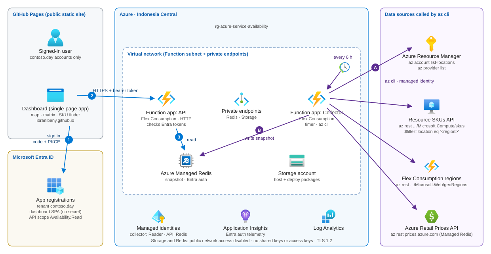

# Azure Service Availability

Region map and availability dashboard for **Azure VM sizes**, **Azure Managed Redis** and 28 more services in every Azure region.
The data is collected **on a schedule by Azure Functions running the Azure CLI**, cached in **Azure Managed Redis**, and served by an API that only accepts **Microsoft Entra ID** tokens from **contoso.day** accounts. The dashboard is a static site on GitHub Pages.

**Dashboard:** https://ibranibeny.github.io/azure-service-availability/ (sign-in required)



## What you get

| View | What it shows |
|---|---|
| Region map | Every region on a zoomable world map, colored by VM sizes, availability zones or any of 30 services. Select a region to see its services, Azure Managed Redis SKUs with list prices, and every VM size with zones, restrictions and capabilities (CSV export). |
| Service matrix | Regions × services grid (available with zone support / available / not offered). |
| VM size finder | Pick a size (e.g. `Standard_D4s_v5`) and see where it's available with zones, regional only, restricted for the subscription, or not offered. |
| Azure Managed Redis | Pick a tier and SKU (e.g. Balanced B5) and see which regions offer it, zone redundancy and the hourly list price. |
| Schedule & changes | The collector schedule, next run, run history, and what changed since the previous run. |

## How the data is collected (scheduled)

`backend/collector` is a Python Function app on the **Flex Consumption** plan with a **timer trigger** (`COLLECT_SCHEDULE`, default `0 0 */6 * * *` = every 6 hours, UTC). Each run signs in with the app's user-assigned managed identity and calls the Azure CLI (installed in the app package and started as `python -m azure.cli`):

| Data | Azure CLI call |
|---|---|
| Regions, geography, coordinates, availability zones | `az account list-locations` |
| Service availability and zone mappings per region | `az provider list` |
| VM sizes, zones, subscription restrictions, capabilities | `az rest` on `/subscriptions/{id}/providers/Microsoft.Compute/skus?$filter=location eq '<region>'` (the API behind `az vm list-skus`; the server-side location filter takes ~5 s per region instead of ~2 min) |
| Functions Flex Consumption regions | `az rest` on `Microsoft.Web/geoRegions?sku=FlexConsumption` |
| Azure Managed Redis SKUs and list prices per region | `az rest` on the Azure Retail Prices API |

The snapshot (summary, one document per region, VM size index, Managed Redis index, change log, run history) is written to Azure Managed Redis in one transaction. If a region fails, its previous data is kept and marked as stale.

## Security

* **Dashboard → API:** Microsoft Entra ID sign-in in the browser (authorization code flow with PKCE, no secret; tokens in session storage). The API validates the token signature, issuer (contoso.day tenant), audience, the `Availability.Read` scope, the calling client (the dashboard app), and rejects guests and accounts outside `contoso.day`.
* **CORS:** the API only allows `https://ibranibeny.github.io`.
* **Function apps → Redis / Storage:** managed identities with Microsoft Entra tokens; Redis access keys and Storage shared keys are disabled; both have public network access disabled and are reached through private endpoints from the Function apps' virtual network.
* **Collector → Azure:** Reader on the subscription only. No subscription ID is published in the data.
* **Monitoring:** Application Insights with Entra authentication (local auth disabled).

## Deploy (Azure Cloud Shell, Bash)

```bash
git clone https://github.com/ibranibeny/azure-service-availability
cd azure-service-availability
bash scripts/deploy.sh          # Indonesia Central by default
```

The script registers resource providers, creates the two app registrations (API + dashboard), deploys `infra/main.bicep`, builds both Function apps locally (Python 3.12), deploys them, starts the first collection and prints the values for `docs/config.js`. Settings can be overridden with environment variables: `LOCATION`, `RG`, `PAGES_URL`, `ALLOWED_DOMAINS`, `SCHEDULE`, `REDIS_SKU`, `ENABLE_NAT`.

Run the collector on demand: `bash scripts/run-collector.sh`.

## Repository layout

```
backend/collector   timer-triggered Function app (az cli -> Azure Managed Redis)
backend/api         HTTP Function app (Entra ID token validation -> Redis -> JSON)
infra               Bicep: Flex Consumption apps, Azure Managed Redis, VNet, private endpoints, storage, monitoring
scripts             deploy, app registrations, build, run collector
docs                GitHub Pages dashboard (no frameworks; Natural Earth base map; official Azure icons)
tests               offline tests for the collector and the token checks
```

## Read the data with care

* "Available" means the resource type or VM size is offered in the region for the collector's subscription. It doesn't guarantee capacity or quota at deployment time.
* "Restricted" VM sizes carry a `NotAvailableForSubscription` restriction for this subscription; other subscriptions can differ.
* Azure Managed Redis SKUs are those with a pay-as-you-go "Cache Instance" meter in the region; prices are list prices in USD per hour. Preview SKUs follow [Scale an Azure Managed Redis instance](https://learn.microsoft.com/azure/redis/how-to-scale).

Base map: [Natural Earth](https://www.naturalearthdata.com/) 1:110m (public domain). Icons: Microsoft Azure architecture icons.
